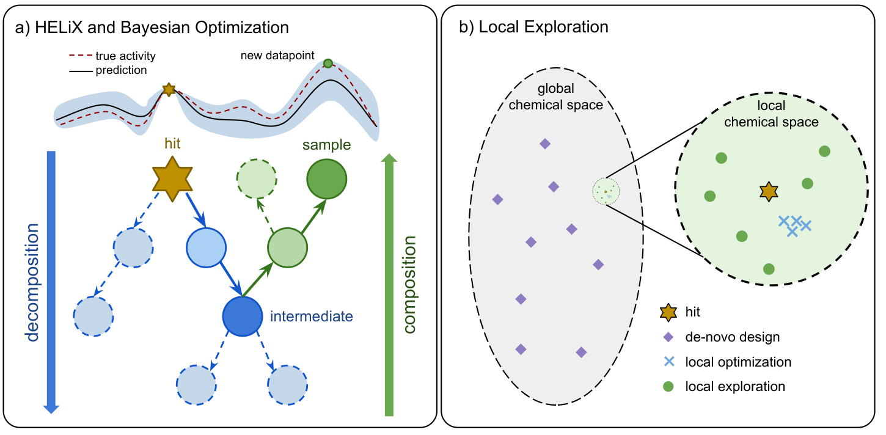

# HELiX: Hit Expansion via Localized Exploration of Synthesizable Chemical Space



Code for "HELiX: Hit Expansion via Localized Exploration of Synthesizable Chemical Space" (TODO: add arXiv link).

HELiX is a template-based GFlowNet framework for **local hit expansion** in synthesizable chemical space. Given a known binder (hit molecule), HELiX decomposes it by reversing reaction steps to an intermediate, then performs forward synthesis to generate analogs which share partial trajectories.


## Installation

```bash
git clone https://github.com/koziarskilab/helix.git
cd helix

conda create -n helix python=3.11
conda activate helix

pip install poetry
poetry install
```

For development tools (pre-commit, pytest):

```bash
poetry install --with dev
```


## Usage

For reproducing paper results, see [`experiments/README.md`](experiments/README.md).

For adapting HELiX to your own task, two top-level runners are provided:

**Train** a GFlowNet policy (no BO):

```bash
python train.py --cfg configs/helix_base.gin
```

**Run** the full BO loop (GFlowNet + GP surrogate + acquisition):

```bash
python run_bo.py --cfg configs/helix_bo.gin
```

Both use [gin-config](https://github.com/google/gin-config). A corresponding run directory with sampled trajectories and metadata will be created at `runs/<run_name>/<timestamp>/`.

To run HELiX with custom configs, write a gin file that includes the HELiX base, a proxy, and an initial hit:

```gin
# my_run.gin
include 'configs/helix_bo.gin'
include 'configs/proxies/target/seh.gin'

run_name = "my_run"
ReactionEnv.starting_smiles_with_budget = [("HIT_SMILES", 1)]
```

`("HIT_SMILES", 1)` contains the SMILES string of the initial hit molecule and the reaction budget (number of additional forward compositions allowed).

Then:

```bash
python run_bo.py --cfg my_run.gin
```


## Building Blocks Library

HELiX requires a library of fragments (building blocks) and reaction templates. The default library lives at `data/small/`:

- `fragments.txt` - building blocks, one SMILES per line
- `templates.txt` - reaction templates as SMARTS, one per line
- `fragment_to_real_cost.json` - per-fragment cost (for cost-aware proxies)
- `yields.csv` - per-reaction yields

Library paths are set in `configs/envs/settings/small.gin` and passed to the `ReactionEnv`. To use a custom library, override these paths in your gin config.


## Citation

```text
TODO
```
